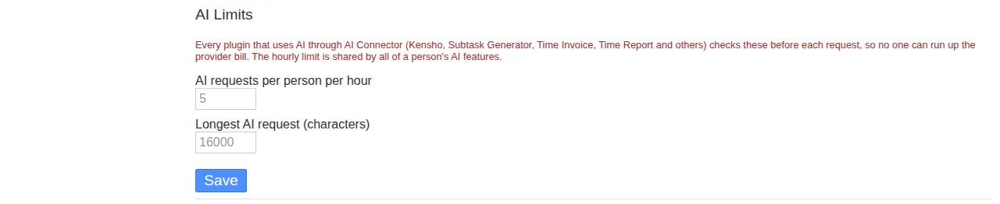
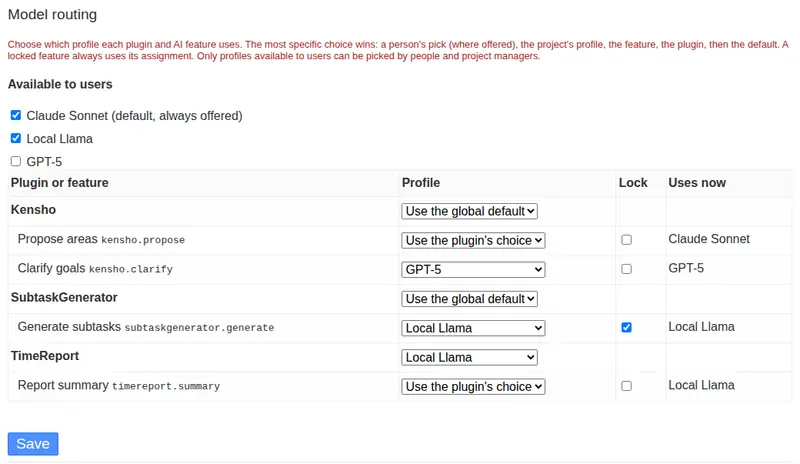
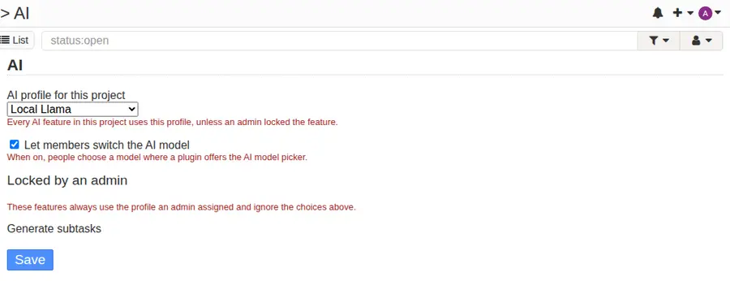

# AiConnector — Kanboard Plugin

Universal multi-provider AI backend for the Kanboard plugin suite. AiConnector
owns provider configuration, API-key storage, and the [`php-agents`](https://github.com/carmelosantana/php-agents)
library, and exposes a small PHP API (`ProviderRegistry`) that other plugins
consume instead of talking to any AI provider directly. It has no user-facing
feature of its own beyond its Settings page — it exists to be depended on.

## Requirements

- Kanboard >= 1.2.47
- PHP >= 8.4
- An API key for at least one hosted provider, or a reachable Ollama server
  (no key required)

## Installation

1. Copy or clone this directory to `<kanboard-root>/plugins/AiConnector/`.
2. Inside the plugin directory, install PHP dependencies (this vendors
   `php-agents` and its HTTP client — there is no way to skip this step):
   ```
   composer install --no-dev
   ```
3. Set file permissions so the web server can read the plugin:
   ```
   chmod -R o+rX AiConnector/
   ```
4. Go to **Settings → Plugins** in Kanboard to confirm the plugin is active.
5. Go to **Settings → AI Connector** to add a provider profile.

## Provider types

AiConnector supports seven provider types, all over HTTP via `php-agents`:

| Provider type | Label | Default model | Env var fallback |
|---|---|---|---|
| `anthropic` | Anthropic (Claude) | `claude-sonnet-5-5` | `ANTHROPIC_API_KEY` |
| `openai` | OpenAI (Chat Completions) | `gpt-4o` | `OPENAI_API_KEY` |
| `openai_responses` | OpenAI Responses (Codex / gpt-5) | `gpt-5` | `OPENAI_API_KEY` |
| `grok` | Grok (xAI) | `grok-3` | `XAI_API_KEY` |
| `gemini` | Google Gemini | `gemini-2.5-flash` | `GEMINI_API_KEY` |
| `mistral` | Mistral | `mistral-large-latest` | `MISTRAL_API_KEY` |
| `ollama` | Ollama (local, keyless) | `llama3.2` | — (honours `OLLAMA_HOST`) |

Both OpenAI-flavored types share the `OPENAI_API_KEY` env var fallback since
they're the same account/key on OpenAI's side — only the API surface
(Chat Completions vs. Responses) differs.

## Profiles + default

Configuration is organized as named **profiles**: `{id, label, provider,
model, base_url}`. Add, edit, and remove profiles from **Settings → AI
Connector**. Exactly one profile can be marked the **default** — it's the one
`ProviderRegistry::buildProvider()` / `structured()` use when a consumer
doesn't pass an explicit profile id.

Any plugin with two or more profiles configured can offer a point-of-use
provider picker instead of always using the default; see SubtaskGenerator's
Generate-subtasks modal for an example.

## Key storage

- API keys are stored **separately** from the profiles list, under
  `aiconnector_key_<profile-id>` in Kanboard's `settings` table — never
  embedded in the profiles JSON itself.
- The key field in the settings form always renders masked (`••••••••`) and
  is never echoed back into the HTML response. Submitting the form with the
  placeholder unchanged, or leaving the field blank, preserves the existing
  stored key.
- Keys are never written to the PHP error log. On a provider failure, only
  the exception class and code are logged — never the exception message,
  request URL, or provider response body.
- As a fallback, when a profile's stored key is empty, AiConnector resolves
  the provider type's env var (see the table above). Ollama is keyless and
  ignores both — it instead honours `OLLAMA_HOST` for the server address (see
  below).
- Ollama base URL resolution order: profile `base_url` override →
  `OLLAMA_HOST` (with `/v1` appended) → `http://localhost:11434/v1`.

## Network security (SSRF guard)

Profiles that call a base URL (OpenAI-compatible, OpenAI Responses, Ollama) are
checked when saved and again before every request, after DNS resolution:

- **Allowed hosts** (Settings → AI Connector → Network Security): one host or IP
  per line, `*.example.com` for subdomains. Empty allows any public host.
- **Private networks** — RFC 1918, loopback, CGNAT (`100.64.0.0/10`), IPv6 `::1`
  and `fc00::/7` — are refused unless **Allow providers on private networks** is
  ticked. A local Ollama (including the `localhost` default and `OLLAMA_HOST`)
  needs it.
- **Always refused**: link-local and cloud metadata (`169.254.0.0/16`, incl.
  `169.254.169.254`; `fe80::/10`; `fd00:ec2::254`; `100.100.100.200`), multicast,
  reserved ranges, IPv4-mapped / NAT64 / 6to4 forms of those, and numeric
  shorthand hosts such as `2130706433`.
- The HTTP client is pinned to the checked address and does not follow redirects.

Anthropic, Grok, Gemini and Mistral call fixed vendor hosts and ignore the base URL.

## AI limits

**Settings → AI Connector → AI Limits** caps what anyone can spend through the
plugins that use AI Connector:

- **AI requests per person per hour** (default 30) — one quota shared by all of a
  person's AI features, over a sliding hour.
- **Longest AI request (characters)** (default 32,000) — the text a plugin sends,
  system prompt and response schema included.



- **AI requests running at once per person** (default 3, ceiling 20) — how many
  streamed requests one person can have open at the same time (v1.5.0). It bounds the
  PHP workers and provider connections a person can hold; the hourly limit bounds spend.

None of the limits can be switched off: the hourly limit goes up to 10,000, the
length cap up to 1,000,000 characters and the concurrent limit up to 20. Test Connection counts against the
admin's own hourly limit. A request past either limit is refused before
it reaches the provider, and the person sees why. A person's requests are checked and
counted one at a time, so parallel requests cannot overshoot the quota.

Plugins that ask for AI Connector 1.3.0 or later use these limits, and keep their
AI features off with an older AI Connector.

## Model routing

AI Connector decides which profile each AI request uses. The most specific choice wins:

1. **A person's pick**, where a plugin shows the AI model picker.
2. **The project's profile**, set on the project's **AI** page by a project manager.
3. **The feature's assignment** and then **the plugin's assignment**, set by an admin.
4. **The global default** profile.

A locked feature skips 1 and 2 and always uses its assignment. A deleted profile,
or one without a key, is skipped (and logged), and the next level is used. A
project profile an admin no longer makes available is skipped too.

**Settings → AI Connector → Model routing** (admins):

- **Available to users**: which profiles people and project managers may choose.
  The global default is always offered.
- A profile per plugin and per AI feature. Plugins list their features here once installed.
- **Lock**: the feature always uses its assignment and shows no picker.



**Project → AI** (project managers): one **AI profile for this project**, and
**Let members switch the AI model**. With the switch off, members see no picker.



Without a project (a personal dashboard, a report across projects), the picker is
shown whenever two or more profiles are available to users and the feature is not locked.

## Test Connection

Each profile row on the Settings page has a **Test Connection** button
(admin-only) that fires a live request through the configured provider and
reports success/failure inline, without leaving the page. It's wired via the
external, CSP-safe `Assets/js/ai-connector.js` — no inline `<script>` blocks.

## The `ProviderRegistry` API (for plugin authors)

Other plugins consume AiConnector by instantiating `ProviderRegistry`
directly — there's no service-container alias to look up:

```php
use Kanboard\Plugin\AiConnector\Model\ProviderRegistry;

$registry = new ProviderRegistry($this->container);
```

Message shape used throughout — a plain array of role/content pairs, no
php-agents types involved:

```php
$messages = [
    ['role' => 'system',    'content' => 'You are a helpful assistant.'],
    ['role' => 'user',      'content' => 'Summarize this task.'],
    ['role' => 'assistant', 'content' => '...'], // optional, prior turns
];
```

Public methods:

- `listProfiles(): array` — `{id, label, provider, model}` per profile (no
  key, no base_url) for populating a dropdown.
- `getDefaultProfileId(): string` — the configured default's id, or `''`
  when none is set or it's dangling.
- `isReady(): bool` — true when at least one profile has a resolvable key
  (stored or env) or is keyless (Ollama). No network call — safe to use for
  gating whether to show an "AI" feature at all.
- `buildProvider(?string $profileId = null): ProviderInterface` — builds a
  configured `php-agents` provider instance for the given profile id (or the
  default). Throws `\RuntimeException` on a missing/unknown profile or
  unsupported provider type; the message never contains a key.
- `structured(array $messages, string $schema, ?string $profileId = null): array`
  — the one call most consumers need. Maps `$messages` to `php-agents`
  message objects, invokes the provider's `structured()`, and normalizes
  **both** of `php-agents`' return shapes (a decoded array for
  Anthropic/OpenAI-Responses tool-use, or a `Response` object with a JSON
  `->content` string for OpenAI/Grok/Gemini/Mistral/Ollama) to a single
  decoded PHP array. Consumers never see or import a
  `CarmeloSantana\PHPAgents\*` class.

### Minimal example

```php
use Kanboard\Plugin\AiConnector\Model\ProviderRegistry;

$registry = new ProviderRegistry($this->container);

if (! $registry->isReady()) {
    // no profile configured / no key resolvable — hide the AI feature
    return;
}

$result = $registry->structured(
    messages: [
        ['role' => 'user', 'content' => 'Return 3 short todo titles for: ship the release'],
    ],
    schema: $mySchemaJson, // provider-specific JSON schema string
    // profileId: null uses the default; pass an explicit id for a point-of-use picker
);

// $result is a decoded PHP array — use it directly.
```

## The `AiQuota` API (v1.3.0+)

Call it before every provider request, with the signed-in user's id, a feature
name and the text you will send. `null` means go ahead (the request is counted);
a string is the refusal to show the user.

```php
use Kanboard\Plugin\AiConnector\Model\AiQuota;

$refusal = (new AiQuota($this->container))->consume(
    $this->userSession->getId(),
    'myplugin.summarize',                       // shown in the log on refusal
    array_column($messages, 'content'),         // string or list of strings
);
if ($refusal !== null) {
    $this->response->json(['error' => $refusal], 429);
    return;
}
```

Call it outside any database transaction (it throws inside one, since a rollback
would erase the count). Feature-detect it (`class_exists(AiQuota::class)`) and keep AI off when it is
missing, so an older AI Connector does not leave your feature unmetered.
`maxInputChars()` gives the cap, for trimming optional context to fit.

## Routing API (v1.4.0+)

Register your AI features in `initialize()`. Ids are the names you pass to `AiQuota::consume()`
and match `^[a-z0-9][a-z0-9._-]{0,63}$`:

```php
$this->hook->on('aiconnector:features', fn () => [
    ['id' => 'myplugin.summary', 'label' => t('My plugin: summary'), 'plugin' => 'MyPlugin'],
]);
```

Before each request, resolve the profile and pass it on:

```php
$registry = new ProviderRegistry($this->container);
$profileId = $registry->resolve('myplugin.summary', $projectId, $this->request->getStringParam('ai_profile') ?: null);
$result = $registry->structured($messages, $schema, $profileId);
```

`resolve()` returns `''` when no level has a ready profile. Pass `null` for `$projectId` when the
request has no single project. Never use the posted `ai_profile` directly: `resolve()` ignores a
pick the person may not make.

Show the shared picker in your form with options computed by your controller:

```php
// controller
'ai_options' => $registry->pickerOptions('myplugin.summary', $projectId),
// template
<?= $this->render('AiConnector:picker/select', ['options' => $ai_options]) ?>
```

It renders nothing when the feature is locked, fewer than two profiles are offered, or the
project does not let members switch. Feature-detect with
`method_exists(ProviderRegistry::class, 'resolve')` and keep AI off without it.

## Streaming API (AiStream) (v1.5.0+)

`AiStream` gives a plugin one guarded stream of events for an AI request. It is
UI-agnostic and has no transport: the host decides whether the events go to a page,
server-sent events or a background job. It runs the guard rails (readiness, signed-in
user, registered feature, model routing, the quota and the attempt key) and charges the
request itself, so a host must not also call `AiQuota::consume()`. No `php-agents`
class appears in any request or event.

```php
use Kanboard\Plugin\AiConnector\Stream\AiRequest;
use Kanboard\Plugin\AiConnector\Stream\AiStream;
use Kanboard\Plugin\AiConnector\Stream\Event;

$request = new AiRequest(
    feature: 'myplugin.summary',          // registered on aiconnector:features
    attemptKey: $this->request->getStringParam('attempt'), // one per user action
    messages: $messages,
    schema: $mySchemaJson,                // null for a plain text stream
    projectId: $projectId,
);

foreach ((new AiStream($this->container))->events($request) as $event) {
    if ($event instanceof Event\TextDelta) {
        // output-encode and show $event->text
    } elseif ($event instanceof Event\Refused) {
        // nothing was sent: show $event->message
    } elseif ($event instanceof Event\Error) {
        // the attempt was charged and failed: show $event->message
    } elseif ($event instanceof Event\Finish) {
        // structured stream: $event->result is the decoded array (reason "stop");
        // run it through your own normalizer and schema checks as before
    }
}
```

Feature-detect with `class_exists(AiStream::class)` and keep streaming off without it.
`events()` never throws for what a request or a provider does; it throws
`InvalidArgumentException` only for programmer errors (malformed messages or attempt key,
schema text that is not JSON), and `LogicException` inside a database transaction.
`AiRequest` takes no user id: the signed-in user is read from the session. `idleTimeout`
(default 60 s, clamped to 1-120) and `maxDuration` (default 300 s, clamped to 1-600)
bound a request. Pass an `AiCancellation` (`isCancelled(): bool`) to let the person stop it.

### Events

All are `final readonly` classes under `Stream\Event\`.

| Event | Fields | When |
|---|---|---|
| `Started` | `model`, `streaming` | the attempt is reserved and the request is about to go; `streaming` is false on the blocking path |
| `TextDelta` | `text` | answer text (text stream) |
| `StructuredDelta` | `json` | a fragment of the JSON document (structured stream) |
| `ReasoningDelta` | `text` | provider reasoning, where the provider sends it |
| `ToolCallStart` | `index`, `id`, `name` | the model opens a tool call (text stream) |
| `ToolCallEnd` | `index`, `id`, `name`, `arguments` | the call's arguments are complete and decoded |
| `Progress` | `elapsedMs`, `receivedChars` | at most once a second while the stream is idle or flowing; the host's heartbeat |
| `Finish` | `reason`, `model`, `usage`, `result` | terminal: the provider answered. `result` only on a structured stream that ended `stop` and decoded to an array |
| `Refused` | `code`, `message` | terminal: no provider request was made and nothing was charged, except `quota` and `too_long`, which are logged but not counted |
| `Error` | `code`, `message` | terminal: the attempt was charged and failed |

A host that drains the generator gets exactly one terminal event, last. `Finish.model` is
the profile's configured model; `usage` is `{promptTokens, completionTokens, totalTokens}`
or null. `message` is a fixed translated sentence; real errors go to the log only.

### Terminal mapping

| Situation | Terminal event |
|---|---|
| No ready profile at all | `Refused(not_ready)` |
| No signed-in user | `Refused(not_signed_in)` |
| Feature not registered on `aiconnector:features` | `Refused(unknown_feature)` |
| Routing finds no ready profile | `Refused(no_profile)` |
| The provider cannot be built (unknown type, unsafe URL) | `Refused(setup_failed)` |
| Input over the length cap | `Refused(too_long)` |
| Same key already used by this user for this feature | `Refused(duplicate_attempt)` |
| Concurrent limit reached | `Refused(too_many_running)` |
| Hourly quota reached | `Refused(quota)` |
| The count could not be stored | `Refused(unavailable)` |
| Cancelled before the reservation | `Refused(cancelled)` (nothing charged) |
| Cancelled after the reservation, before the request | `Finish(cancelled)` (charged) |
| Provider finished: stop, tool use, max tokens, refusal, content filter, context window exceeded | `Finish(stop / tool_use / max_tokens / refusal / content_filter / context_window_exceeded)` |
| Provider paused the turn | `Finish(incomplete)` |
| Provider error, premature end of stream, tool-call overflow | `Error(provider_error)` |
| Idle or total time limit passed | `Error(timeout)` |
| Transport or HTTP failure, anything else | `Error(provider_error)` |
| The stream ends with no finish | `Error(provider_error)` |
| Cancelled before a finish arrives | `Finish(cancelled)` |
| Finish already received, then cancelled | the provider's `Finish` stands |
| Structured: `stop`, but the document does not decode to an array | `Finish(invalid_output)` |
| Structured: the document is over the size or depth cap | `Finish(output_too_large)` |

### Host checklist

Before building an `AiRequest`, the host:

- checks CSRF and that the person may use this feature on this project, task or resource (project
  membership, task visibility); AiConnector's routing reads the project's settings but authorizes
  nothing;
- generates the attempt key per user action, server-side or from a client nonce it validates;
- owns cancellation: only the person who started an attempt may stop it;
- runs long requests with `session_write_close()` and `ignore_user_abort(true)`, as AgentChat does;
- treats every delta, reasoning, tool argument and result as untrusted output;
- persists results if it wants to answer duplicates or recover lost answers;
- replaces its own `AiQuota::consume()` call: `AiStream` charges, so a host must not charge again.

### Notes

- The attempt key is required and is the host's idempotency key for one action (1-64 characters of
  `A-Za-z0-9._-`). The same key again is refused as `duplicate_attempt` whether the first attempt is
  running or done, and is never charged. AiConnector stores no output, so it cannot replay one.
  Regenerate is a new key and a new charge, always an explicit action by the person.
- The blocking path is used for providers without native streaming. It sends no `Progress`, and
  cancellation is checked only before the call.
- Structured requests currently answer through one blocking `structured()` call
  (`Started(streaming: false)`, the document as one `StructuredDelta`). A streamed structured
  response is planned with php-agents 0.21; it is not available yet.
- A `ToolCallStart` without a matching `ToolCallEnd` means the call was not completed (it was
  dropped for an invalid name or id).
- Requires the PHP `mbstring` extension (php-agents 0.19 needs it, and so does Kanboard).

## ModelCatalog API (v1.1.0+)

Discover a model's context window and estimate token counts. Construct it like
`ProviderRegistry`:

```php
use Kanboard\Plugin\AiConnector\Model\ModelCatalog;

$catalog = new ModelCatalog($this->container);

$max    = $catalog->getContextWindow($profileId);          // int, e.g. 131072
$tokens = $catalog->countTokens($text, $profileId);        // heuristic int estimate
$budget = $catalog->getInputBudget($profileId);            // fits-in-prompt int (reserves 1024 output)
$budget = $catalog->getInputBudget($profileId, 2048);      // custom output reserve
```

- `$profileId` is optional everywhere; `null` uses the default profile.
- **All three methods are non-throwing.** An unknown/missing profile, an
  unreachable Ollama, or an unknown model id falls back to a conservative value.
- **Context resolution:** for Ollama profiles a live `/api/show` lookup runs and
  is cached for 24h; all providers fall back to a curated table
  (`ModelContextTable`, `LAST_VERIFIED` dated) and finally a 8192 default.
- **Token counting** is heuristic (no network, no tiktoken dependency): ~4
  chars/token (3.5 for Anthropic).

Typical "fit the prompt" loop:

```php
$budget = $catalog->getInputBudget($profileId);
while ($catalog->countTokens($draft, $profileId) > $budget) {
    $draft = shrink($draft);
}
```

Consumers should treat AiConnector as an optional (`recommends`) dependency and
guard usage with `class_exists(ModelCatalog::class)`.

## php-agents load-order rule

AiConnector is the **only** plugin in this suite that bundles `php-agents`
(vendored under `vendor/`). Kanboard gives no guarantee about plugin
`initialize()` call order, so:

- AiConnector's own `initialize()` loads `vendor/autoload.php` but never
  references a `CarmeloSantana\PHPAgents\*` class at init time.
- Consumer plugins (e.g. SubtaskGenerator) must **never** reference a
  `CarmeloSantana\PHPAgents\*` class, and should avoid triggering autoload of
  one, during their own `initialize()`. Only call into `ProviderRegistry`
  methods that touch `php-agents` (`buildProvider()` / `structured()`) at
  request-handling time — inside a controller action, not plugin bootstrap.
  `listProfiles()`, `getDefaultProfileId()`, and `isReady()` are safe at any
  time since they touch no `php-agents` class.

## License

MIT — see [LICENSE](LICENSE).
